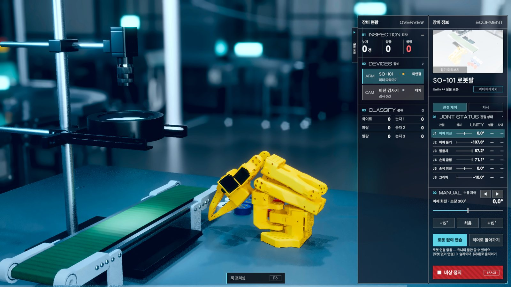
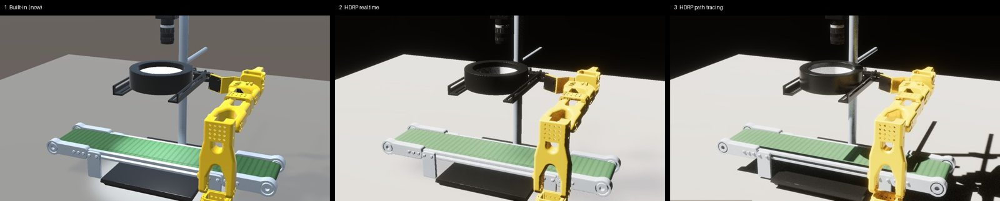
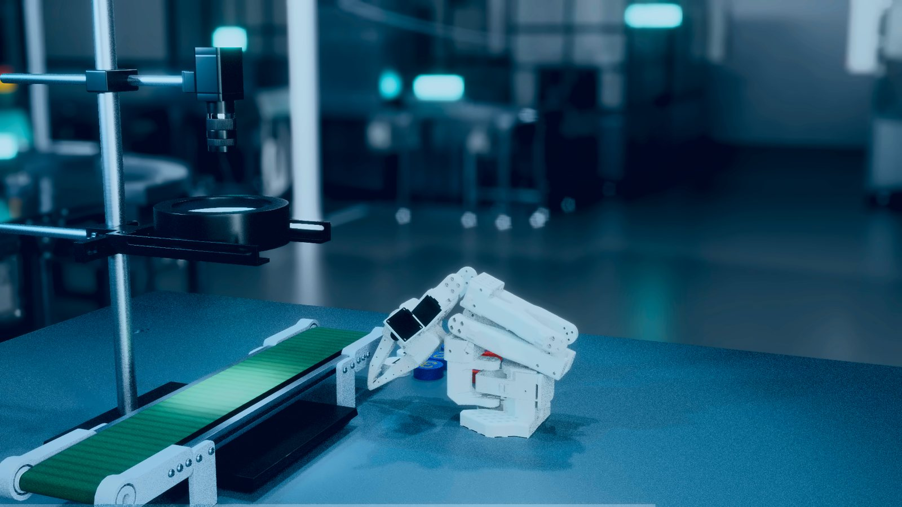
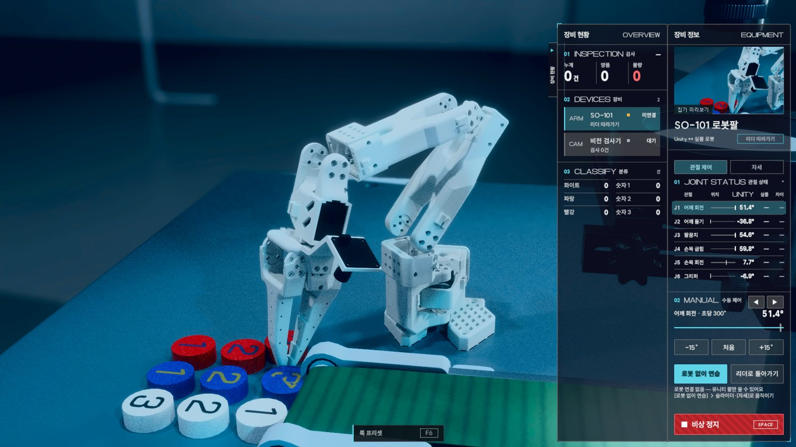
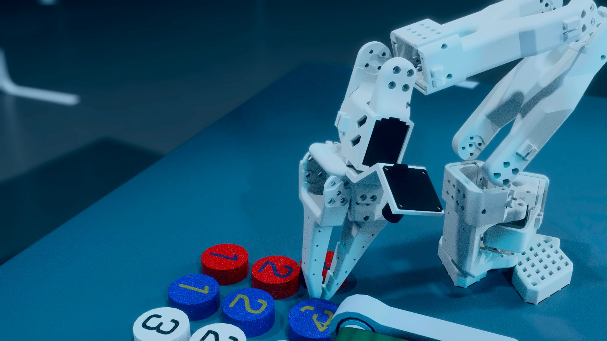
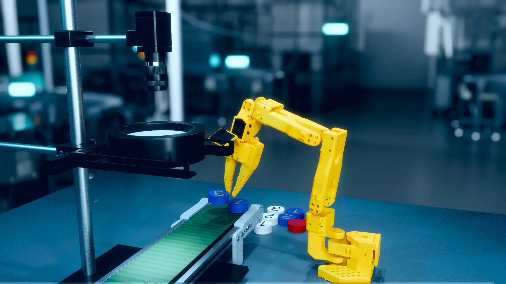
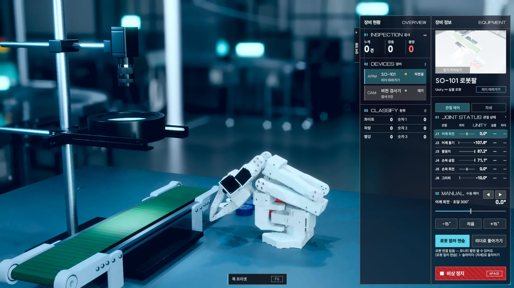
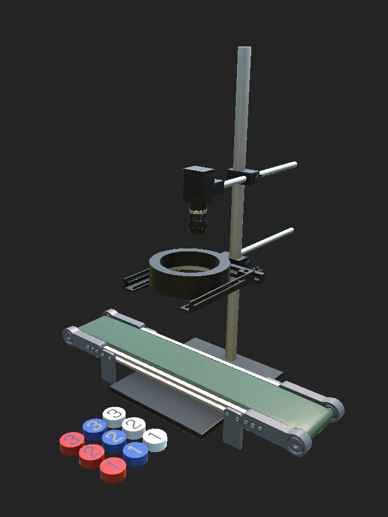
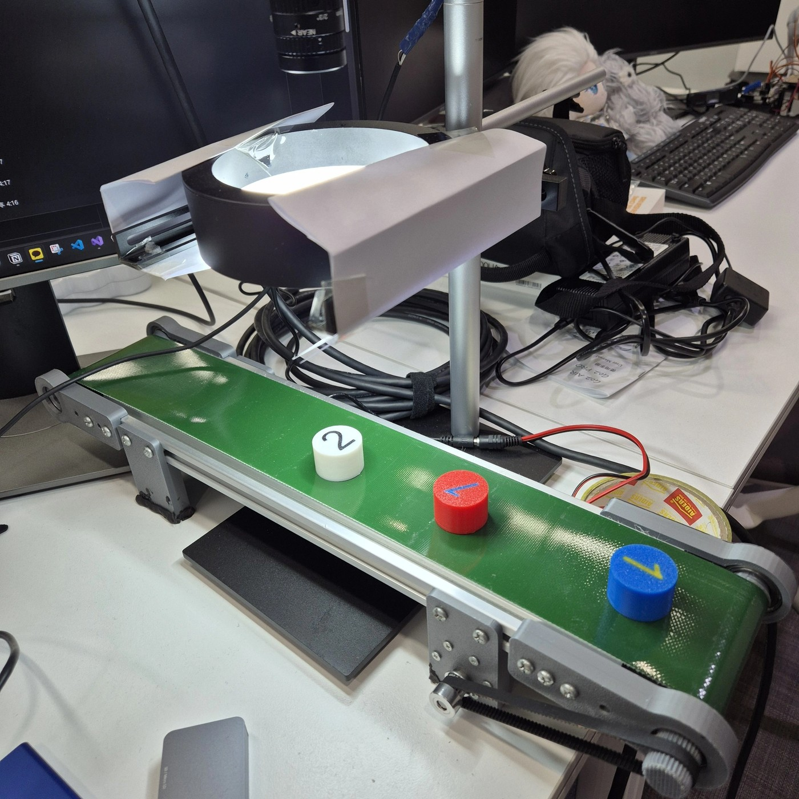

# CameraDigitalTwin — SO-101 로봇팔 학습 시뮬레이터 (Unity)

실물 로봇팔(SO-ARM101)과 똑같이 움직이는 **디지털 로봇팔 학습 시뮬레이터**입니다. 실습실에 로봇팔은 한 대뿐이라, 여러 학생이 Unity 안에서 같은 실습(관절 조작, 자세 저장·재생, 컨베이어 위 뚜껑 집기)을 하고, 같은 동작을 실제 로봇팔로 재현할 수 있게 했습니다. 기반은 산업용 카메라 검사 결과를 Unity 컨베이어 위에 재현하는 디지털트윈입니다.

🔗 [Portfolio](https://subinlu22.github.io)

<p align="center">
  <br>
  <sub>고퀄 버전(HDRP 경로 추적) 렌더 + 시뮬레이터 패널 UI</sub>
</p>

---

## 개요

| 항목 | 내용 |
|---|---|
| 기간 | 2026.09 ~ 2026.11 |
| 인원 / 역할 | 1인 — 3D 모델링, Unity 구현, 로봇 연동(Python), UI, 렌더 |
| 목적 | 실물과 같은 디지털 로봇팔로 여러 명이 동시에 실습 → 시뮬레이션한 동작을 실물에서 그대로 재현 |
| 로봇 | SO-ARM101 리더 팔(손으로 움직이는 조종기) + 팔로워 팔(실제로 일하는 팔), Feetech STS3215 서보 각 6개 |

### 단계

| 단계 | 내용 | 상태 |
|---|---|---|
| 1 | 실물 → Unity 미러링 (리더 팔 각도를 Unity 팔이 따라 함) | ✅ |
| 2 | Unity → 실물 (Unity에서 조작·재생한 동작을 팔로워 팔이 따라 함, 안전장치 포함) | ✅ |
| 3 | 뚜껑 집기 (Unity 안에서 집기 → 같은 자세 목록으로 실물 집기) | ✅ |
| 4 | 학습 도구화 (연습 모드, 자세 저장·재생 UI, 렌더 룩 콘솔) | ✅ 일부 (빌드 exe 확인 전) |

## 두 가지 버전

렌더 품질이 원하는 만큼 나오지 않은 원인이 Built-in 렌더 파이프라인의 한계로 확인되어(아래 트러블슈팅), 용도별로 나눴습니다.

| | 라이트 버전 (이 저장소 `main`) | 고퀄 버전 (HDRP 실험 복사본) |
|---|---|---|
| 용도 | 실습용 시뮬레이터 (실시간, 저사양 PC) | 포트폴리오 사진·데모 영상 |
| 렌더 | Built-in Render Pipeline, 실시간 | HDRP + 경로 추적(Path Tracing) |
| 장면 | 같은 장면·모델·스크립트 | 같은 장면, 조명·재질만 HDRP용으로 조정 |

<p align="center">
  <br>
  <sub>같은 모델 비교 — Built-in / HDRP 실시간 / HDRP 경로 추적</sub>
</p>

## 스크린샷 (고퀄 버전)

| | |
|---|---|
|  |  |
| 검사 카메라·링라이트·컨베이어·로봇팔 | 뚜껑 집기 자세와 패널 관절 값 |
|  |  |
| 집게가 뚜껑을 잡는 장면 | 집은 뚜껑을 컨베이어에 올리는 장면 |

<p align="center">
  <br>
  <sub>실물 팔로워 팔(흰색)에 맞춘 색 버전</sub>
</p>

## 할 수 있는 것

| 기능 | 상태 |
|---|---|
| 리더 팔을 Unity 팔이 따라 하기 (30Hz, 미러링) | ✅ |
| Unity에서 6관절 조작 (관절 고르기 → 슬라이더·±15°) → 팔로워 팔이 따라감 | ✅ 실물 확인 |
| 벨트를 피해서 자세 옮기기 (위로 들기 → 어깨 회전 → 내려가기) | ✅ |
| 자세 저장 — 그룹(동작)별 자세 목록, 이름 바꾸기·순서·삭제 | ✅ |
| 저장한 자세를 순서대로 재생 → 실물로 뚜껑 집어 컨베이어에 올리기 | ✅ 실물 확인 |
| 로봇 없이 연습 (패널·로봇 연결 없이 Unity 팔만) | ✅ |
| 연속 동작 녹화 → 절반 속도 재생 | ✅ (실물 재생은 확인 전) |
| Unity 안에서 뚜껑 집기 (재생 중 연습용 뚜껑을 손가락 사이에 놓음) | ✅ |
| 가벼운 연습 룩 ↔ 데모 룩(F5), FPS 표시(F4), 룩 프리셋 창(F6) | ✅ 에디터 확인 |
| 렌더 룩 콘솔 (따로 뜨는 창에서 조명·부위 재질을 골라 실시간 반영) | ✅ 에디터 확인 |
| 카메라 검사 결과 → 같은 색·숫자 뚜껑을 벨트 위에 재현 | ✅ |
| 빌드 exe 하나로 연습·실물 모드 | ⏳ 확인 전 |

## 환경 · 기술 스택

| 구분 | 내용 |
|---|---|
| 엔진 | Unity 6 (6000.3.11f1) — 라이트: Built-in RP / 고퀄: HDRP 17 + 경로 추적 |
| 언어 | C# (Unity), Python (리더 허브·로봇 브리지·컨트롤 패널·렌더 룩 콘솔) |
| 로봇 | URDF Importer(`Packages`에 직접 포함) + ArticulationBody, 시리얼(pyserial) |
| 모델링 | Maya, Substance Painter (컨베이어·카메라·링라이트·뚜껑 9종) |
| 환경 에셋 | Poly Haven HDRI·모델, ambientCG 재질 (CC0) |
| 통신 | UDP (같은 PC 안) |
| UI | Unity UGUI(코드로 생성), 로컬 웹(컨트롤 패널·렌더 룩 콘솔, Edge 앱 창) |

## 시스템 구조

```
[리더 팔] ─USB─▶ leader_hub ─UDP 5060─▶ Unity (LeaderArmReceiver) ── 미러링
                                     │
                              Unity 팔 6관절 목표 각도
                              (RobotJointTester: 초당 속도 제한)
                                     │
                 UnityTargetSender ─UDP 5063─▶ [컨트롤 패널 브리지] ─USB─▶ [팔로워 팔]
                 UnityToFollowerGUI ─UDP 5061(명령) / 5062(상태)─┘
                                      안전 범위 자르기 · 속도 제한 · 0.3초 끊김 정지 · 벨트 충돌 검사

[카메라 검사 프로그램] ─UDP 5053─▶ DigitalTwinReceiver ─▶ 같은 색·숫자 뚜껑 생성 → 벨트 이동

[렌더 룩 콘솔(웹)] ─UDP 5070/5071─▶ RenderLookCore ─▶ 조명·부위 재질 실시간 반영
```

| 스크립트 / 도구 | 역할 |
|---|---|
| `UnityToFollowerGUI` | 모드 전환 (리더 / 연습 / 실물 / 로봇 없이 연습), 브리지 명령·상태 |
| `RobotJointTester` | 관절 목표 각도를 초당 정한 속도로만 넣음 |
| `ArmPoseMover` | 벨트를 피하는 경유 자세 계산 |
| `PoseLibrary` | 자세·그룹·녹화 동작 저장(`StreamingAssets/so101_poses.json`), 순서대로 재생 |
| `PracticeLid` / `GripperGrab` | 연습용 뚜껑 놓기 / 두 손가락이 닿고 더 쥐면 잡고, 벌리면 놓음 |
| `TwinSidePanel` (+ `.Poses`) | 오른쪽 패널: 장비 현황·관절 표·수동 제어 / [자세] 탭 |
| `DigitalTwinReceiver` · `LidMover` | 카메라 판정 수신 → 뚜껑 생성 → 벨트 등속 이동 → 끝에서 낙하 |
| `Assets/RenderLookConsole` | 어느 장면에나 붙는 렌더 룩 플러그인 (부위 자동 찾기, 원래대로 복원) |
| `Tools/leader_hub` | 리더 팔 6관절을 읽어 UDP로 보냄 (읽기 전용) |
| `Tools/so101_bridge` | 팔로워 팔에 쓰는 유일한 길 — 안전 규칙 담당, 컨트롤 패널 |
| `Tools/render_console` | 렌더 룩 콘솔 (실사 라이브러리, 레퍼런스 색 맞추기, 부위 대조) |

메시지 형식: [`docs/so101_messages.md`](docs/so101_messages.md) · [`docs/render_look_messages.md`](docs/render_look_messages.md) · 안전 규칙: [`docs/so101_safety.md`](docs/so101_safety.md)

## 안전 설계

| 결정 | 이유 |
|---|---|
| 팔로워 팔에 쓰는 건 브리지 하나뿐 | 안전 범위·속도·끊김 정지를 한곳에서 확인 |
| [흰 팔 실제로 움직이기]는 두 번 눌러야 시작, 6관절 차이 2° 안일 때만 | 켜는 순간 튀는 것 방지 |
| Unity 쪽도 속도 제한 | 슬라이더를 확 끌어도 실물은 천천히 |
| 크게 움직일 땐 위로 든 뒤 옮김, 쉬는 자세는 어깨 +45° 먼저 | 한꺼번에 움직이면 집게가 벨트·뚜껑을 밀었음 |
| 로봇 없이 연습 모드는 브리지로 아무것도 안 보냄 | 연결이 나중에 생겨도 실물이 갑자기 안 움직이게 |
| 집게는 "보낸 명령 각도"로 저장 | 막혀서 멈춘 실제 각도로 재생하면 쥐는 힘이 빠져 놓침 |
| 신호 0.3초 끊기면 자동 정지, Space = 비상 정지 | 통신 문제·실수에 대비 |

## 트러블슈팅

| 문제 | 원인 | 해결 |
|---|---|---|
| Unity 조종을 켜는 순간 팔이 ㄱ자로 튐 | 슬라이더 기본값 0° | 켤 때 지금 목표 각도를 슬라이더에 먼저 넣음 |
| 6관절을 한꺼번에 옮기면 집게가 벨트를 밂 | 관절마다 도착 시간이 달라 중간 자세가 낮아짐 | 위로 들기 → 어깨 회전 → 내려가기 |
| 쉬는 자세에서 나올 때 벨트에 닿음 | 접힌 팔이 벨트 쪽으로 펴짐 | 어깨 +45° 먼저, 팔 먼저 펴고 손목 |
| 재생한 집게가 뚜껑을 놓침 | 실제(막힌) 각도로 재생 → 서보 힘이 거의 0 | 집게는 명령 각도로 저장 |
| 손가락 사이에 뚜껑이 안 들어감 | 볼록 충돌 모양이 손가락 사이를 막음 | 손가락 크기의 얇은 상자 충돌체로 바꿈 |
| 룩·재질 숫자를 바꿔도 실사처럼 안 나옴 (물체가 떠 보이고 칙칙함) | Built-in 파이프라인 한계(실시간 간접광·접촉 그림자 없음) + 장면의 원래 조명·반사판·후처리가 프리셋 위에 겹침 | 같은 모델을 Built-in / HDRP 실시간 / HDRP 경로 추적으로 비교 → 시뮬레이터는 Built-in, 사진·영상은 HDRP로 분리 |
| HDRP 경로 추적 사진이 완전히 검게 나옴 | 배경 흐림을 물리 카메라 방식으로 켬 | 물리 카메라 없이 후처리 배경 흐림 사용 |
| 경로 추적 누적 중 Unity가 꺼짐 | 수백 장을 한 번에 몰아 그려 그래픽카드 시간 초과 | 편집기 한 번 돌 때 4장씩 나눠 그리고, 찍는 동안 일시정지 (물리가 움직이면 누적이 리셋됨) |
| HDRP로 옮긴 뒤 금속이 회색 플라스틱처럼 보임 | 변환 때 금속값이 감마 보정으로 낮아짐(0.55→0.27), 금속에 비칠 밝은 것이 없음 | 금속 부위만 값 복원 + 화면 밖 반사판 |
| HDRP에서 공장 배경·표시등이 어두움 | Built-in은 라이트맵(구운 빛)으로 밝혔고, 변환 때 발광 값이 0으로 빠짐 | 천장 아래 면 조명 + 표시등 발광 다시 켬 |
| 원본 Unity와 HDRP 복사본을 같이 켜면 멈추고 꺼짐 | 두 에디터가 그래픽카드·메모리를 나눠 씀 | 찍을 땐 원본을 끄고 복사본만 실행 |

## 실행 방법

1. Unity Hub에서 **Unity 6000.3.11f1**로 프로젝트를 엽니다.
2. 환경 에셋(HDRI·재질)은 용량 때문에 git에서 제외 → `python Tools/fetch_polyhaven.py`로 받습니다.
3. `SampleScene`을 열고 Play.
4. **로봇 없이 연습**: 오른쪽 패널 로봇 카드 → [로봇 없이 연습] → [자세] 탭에서 그룹 고르고 [▶ 순서대로 재생]
5. **실물**: `Tools/so101_bridge`에서 `python panel.py` → [두 팔 연결] → Unity [유니티로 조종] → 차이 2° 안이면 [흰 팔 실제로 움직이기] 두 번
6. **녹화**: [● 녹화] → 팔 움직이기 → [■ 멈춤] → [▶ 동작 재생 ½]
7. **렌더 룩 콘솔**: `Tools/render_console/start.bat` → 룩 카드·부위 재질을 고르면 Unity에 바로 반영 (F6 = Unity 안 프리셋 창)
8. **카메라 검사 연동**: [CameraNumberDetect](https://github.com/subinlu22/CameraNumberDetect)를 실행하면 판정한 뚜껑이 벨트 위에 생성됩니다 (UDP 5053).

## 데모

| [](https://youtu.be/XKPuIZVpcmo) | [](https://youtu.be/QqhlZ-_pYNY) |
|---|---|
| 제품 스폰 시뮬레이션 및 이송 과정 | 적색 임계값 기반 비전 판정 검사 |

- 로봇팔 미러링·실물 집기 영상: 정리 중

---

## 기반 프로젝트 — 컨베이어 검사 디지털트윈

산업용 카메라 검사 프로그램([CameraNumberDetect](https://github.com/subinlu22/CameraNumberDetect))의 판정 결과를 UDP로 받아, Unity 컨베이어 위에 같은 색·숫자의 뚜껑을 실시간으로 재현합니다. 벨트·카메라·링라이트·뚜껑은 Maya로 모델링하고 Substance Painter로 텍스처링했습니다.

<p align="center">
  
  <br>
  <sub>직접 모델링한 장비(뚜껑 9종: 색 3 × 숫자 3)와 대응하는 실제 장비</sub>
</p>

| type (UDP 5053) | 동작 |
|---|---|
| `inspection` | 검사 결과 1건 → 같은 색·숫자의 뚜껑 생성, 통계 갱신, 판정 테두리 효과 |
| `criterion` | 검사 기준 변경 → 양품/불량 집계를 0부터 다시 시작 (총 검사·색상별·숫자별은 유지) |

| 결정 | 근거 |
|---|---|
| 벨트 위 이동은 물리가 아니라 위치를 직접 이동 | 매번 똑같이 움직여 현실 장비와 맞추기 쉬움. 낙하 연출에만 물리 사용 |
| 수신 스레드와 처리 분리 (큐 사용) | Unity 오브젝트는 메인 스레드에서만 다룰 수 있음 |
| SpawnPoint / EndPoint를 FBX 밖에 둠, 견본 뚜껑은 이름으로 연결 | 모델을 다시 내보내도 연동이 깨지지 않음 |
| URDF Importer를 `Packages` 폴더에 직접 포함 | git 주소 설치가 Unity에서 실패 → 프로젝트와 함께 커밋해 다른 PC에서도 동작 |
| 로봇팔을 visual 전용 URDF로 가져오기 | 충돌 포함 원본은 Mesh Filter가 Missing → `<collision>` 블록만 빼고 링크·관절·범위·질량은 유지 |

---

🔗 [Portfolio](https://subinlu22.github.io)
