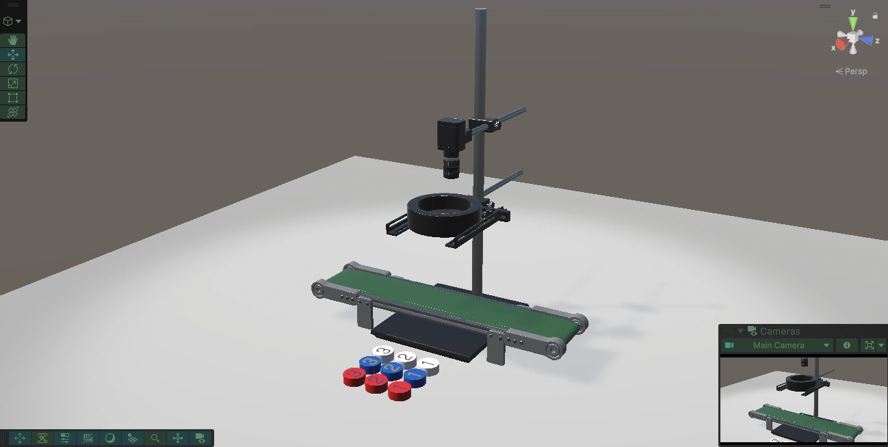
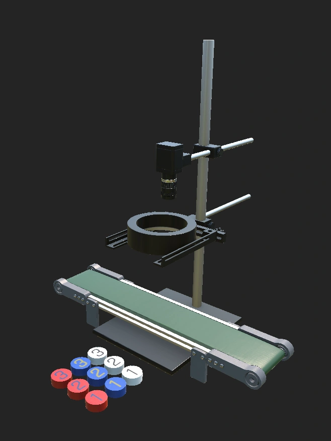
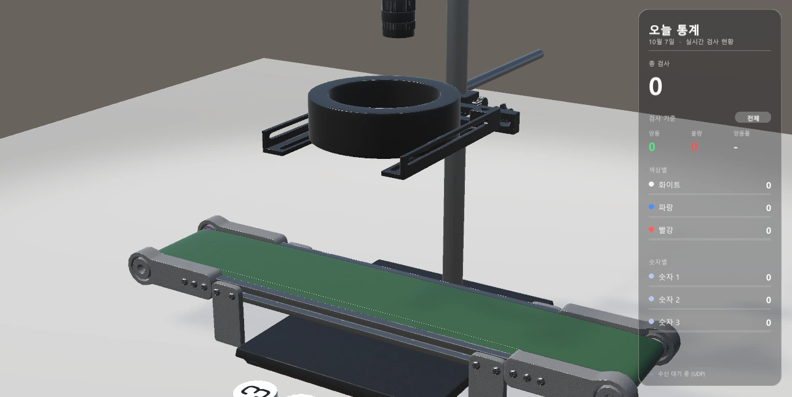

# CameraDigitalTwin — 컨베이어 검사 디지털트윈 (Unity)

산업용 카메라 검사 프로그램([CameraNumberDetect](https://github.com/subinlu22/CameraNumberDetect))의 판정 결과를 UDP로 받아, **Unity 안의 컨베이어벨트 위에 같은 색·숫자의 뚜껑을 실시간으로 재현**하는 디지털트윈입니다. 벨트·카메라·링라이트·뚜껑은 Maya로 직접 모델링하고 Substance Painter로 텍스처링했습니다.

🔗 [Portfolio](https://subinlu22.github.io)


*Unity 에디터 Scene 뷰 — 벨트, 카메라 거치대, 링라이트, 뚜껑 9종*

---

## 데모

| [](https://youtu.be/XKPuIZVpcmo) | [](https://youtu.be/QqhlZ-_pYNY) |
|---|---|
| 제품 스폰 시뮬레이션 및 이송 과정 | 적색 임계값 기반 비전 판정 검사 |

## 프로젝트 개요

| 항목 | 내용 |
|---|---|
| 기간 | 2026.09 ~ |
| 인원 / 역할 | 1인 — 3D 모델링, Unity 구현, UDP 연동, 로봇팔 가져오기 |
| 목적 | 현실 장비의 검사 결과를 가상 공간에 실시간 반영 (현실 ↔ 가상 동기화) |
| 연동 대상 | [CameraNumberDetect](https://github.com/subinlu22/CameraNumberDetect) (UDP 포트 5053) |

## 구현 현황

| 기능 | 상태 |
|---|---|
| 카메라 프로그램 ↔ Unity UDP 연동 | ✅ |
| 판정 결과대로 뚜껑 생성 → 벨트 이동 → 끝에서 낙하 | ✅ |
| 대시보드 (총 검사, 양품/불량/양품률, 색상별·숫자별 개수) | ✅ |
| 판정 순간 화면 테두리 효과 (양품 초록 / 불량 빨강) | ✅ |
| 컨베이어벨트·카메라 URDF 변환 | ✅ |
| SO-101 로봇팔 URDF 가져오기, 관절 테스트 스크립트 | ✅ |
| 로봇팔 관절 각도를 UDP로 받아 실제 로봇팔과 연동 | 🔲 진행 중 |
| 뚜껑 위치를 매 프레임 동기화 | 🔲 계획 |
| 로봇팔로 뚜껑 집기 | 🔲 계획 |

## 환경

| 구분 | 내용 |
|---|---|
| 엔진 | Unity 6 (6000.3.11f1), 3D Built-in Render Pipeline |
| 언어 | C# |
| 모델링 | Maya (FBX `cam_s_merge`, FBX Scale Factor 2.2), Substance Painter |
| 로봇 | URDF Importer (`Packages` 폴더에 직접 포함), ArticulationBody |
| 통신 | UDP, 포트 5053 |


*직접 모델링한 장비 (뚜껑 9종: 색 3 × 숫자 3)*


*대응하는 실제 장비*

## 시스템 구조

```
[카메라 프로그램] ──UDP 5053──▶ DigitalTwinReceiver
                                  │  수신은 별도 스레드 → 큐 → Update(메인 스레드)에서 처리
                                  ▼
              같은 색/숫자의 견본 뚜껑을 복제해 SpawnPoint에 생성
                                  ▼
              LidMover: 벨트 위는 위치를 직접 이동 → EndPoint에서 물리를 켜 낙하 → 3초 뒤 삭제
                                  ▼
              DashboardUI 갱신 · 판정 테두리 효과
```

| 구성 요소 | 역할 |
|---|---|
| `DigitalTwinReceiver` | UDP 수신, 메시지 type(`inspection` / `criterion`) 구분, 뚜껑 생성 |
| `LidMover` | 벨트 위 등속 이동, 끝점에서 낙하 처리 |
| `DashboardUI` | 코드로 만드는 우측 글래스 패널 (통계, 검사 기준 배지, 비율 막대) |
| `SpawnPoint` / `EndPoint` | FBX 밖 빈 오브젝트 (모델을 교체해도 연동이 깨지지 않게 분리) |
| `DroopRobotPose` | 로봇팔 중력·저항·충돌 설정 |
| `RobotJointTester` | 인스펙터 슬라이더로 6개 관절 각도 제어 |


*대시보드 UI (수신 대기 상태)*

## UDP 메시지 (포트 5053)

| type | 동작 |
|---|---|
| `inspection` | 검사 결과 1건 수신 → 같은 색·숫자의 뚜껑 생성, 통계 갱신, 테두리 효과 |
| `criterion` | 검사 기준 변경 알림 → 양품/불량 집계를 0부터 다시 시작 (총 검사·색상별·숫자별은 유지) |

> 로봇팔·아두이노 메시지는 `type`만 추가하면 같은 구조로 확장됩니다.

## 설계 결정과 근거

| 결정 | 근거 |
|---|---|
| 벨트 위 이동은 물리가 아니라 위치를 직접 이동 | 매번 똑같이 움직여 현실 장비와 맞추기 쉬움. 물리는 낙하 연출에만 사용 |
| 수신 스레드와 처리 분리 (큐 사용) | Unity 오브젝트는 메인 스레드에서만 접근 가능 |
| SpawnPoint / EndPoint를 FBX 밖에 둠 | FBX를 다시 내보내도 연동이 깨지지 않음 |
| URDF Importer를 `Packages` 폴더에 직접 복사 | Unity에서 git 주소 설치가 실패했고, 프로젝트와 함께 커밋되어 다른 PC에서도 동작 |

## 트러블슈팅

| 문제 | 원인 | 해결 |
|---|---|---|
| URDF Importer 설치 실패 (`fatal: not in a git directory`) | Unity가 PC의 git을 인식하지 못함 | 패키지 폴더를 `Packages`에 직접 복사 |
| 로봇팔을 충돌 포함 URDF로 가져오면 Mesh Filter가 Missing | 원인 미확정 (충돌용 STL 복사, 폴더 재생성 모두 실패) | `<collision>` 블록을 뺀 visual 전용 URDF로 우회 |
| 같은 URDF를 다시 가져오면 기존 로봇까지 Missing | 같은 STL이 프로젝트에 중복 | 가져온 직후 프리팹으로 저장, 다시 가져와야 하면 폴더를 전부 지우고 시작 |
| 로봇팔이 힘 풀린 경첩처럼 처지고 바닥을 뚫음 | ArticulationBody의 Stiffness/Damping이 0, 충돌 없음 | `DroopRobotPose`로 중력·저항·MeshCollider를 코드에서 설정 |
| 가져올 때 붙는 기본 Controller가 매 프레임 예외 발생 | 구 Input 클래스 사용 | 기본 Controller 컴포넌트 제거 |
| 플레이 중 설정이 종료 시 되돌아감 | 에디터의 플레이 모드 변경은 저장되지 않음 | `Awake()`에서 코드로 직접 설정 |

## 실행 방법

1. Unity Hub에서 **Unity 6000.3.11f1**로 프로젝트를 엽니다.
2. `SampleScene`을 열고 Play를 누르면 UDP 5053 포트에서 수신을 시작합니다.
3. [CameraNumberDetect](https://github.com/subinlu22/CameraNumberDetect)를 실행해 뚜껑을 판정하면 Unity 벨트 위에 같은 뚜껑이 생성됩니다.
4. 카메라 없이 확인하려면 컴포넌트 `⋮` 메뉴의 **테스트: 빨강1 생성**, **테스트: 파랑2 불량**을 사용합니다.

---

🔗 [Portfolio](https://subinlu22.github.io)
